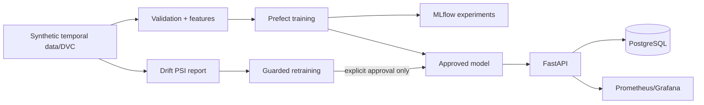

# Architecture

The synthetic generator has a fixed seed and includes 24,000 temporal customer observations. `event_date` determines the 70/15/15 chronological split. Features never use future outcomes. PSI is used for deterministic lightweight drift gates; Evidently can be added as an HTML reporting backend without changing this contract.
